(Human-written text starts)
This is an exercise in assessing the bioinformatics capabilities of agentic AI. It is part of a hackathon run by the Beltrao lab at ETH Zurich, where we used Claude to run bioinformatics projects (LINK). All results in this project were generated entirely by AI with minimal human intervention. This is not intended to be viewed as a traditional publication.

[Project-specific text] The goal of this specific project was to investigate protein 3d structure evolution. It was executed by Claude Opus 5.5 with delegation to Opus 5.5/Sonnet 5.5 subagents, and finished within 48 hours on a computational cluster with 48 cpus, 500 RAM, and a GPU.

Currently none of the results have been verified by a human. We plan to verify the agent's methodology and benchmarking, and we will update this section accordingly.

The rest of this repository is entirely AI generated. It includes code for implementation of the research and a AI-written report in the style of a journal article, detailing the final method, the path followed to reach it, and benchmarking against other methods.
(Human-written text ends)

---

# Is protein structure a molecular clock? Revisiting structural divergence with predicted structures, orthology and divergence times

## Abstract

Protein structure is often said to be "more conserved than sequence" and to change "linearly" with it. These claims rest on small sets of crystal structures and measure evolution in amino-acid substitutions, not in time. We revisited them with AlphaFold models for 180 eukaryotic proteomes, ortholog families inferred from sequence alone, and dated species trees. Amino-acid (AA) change was compared with change in Foldseek's 20-letter structural alphabet (3Di) under matched maximum-likelihood models. Six tests were pre-registered, tuned on 20% of 7,000 families and confirmed once on the other 80%.

The pre-registered tests found that:
- structure diverges more slowly than linearly with sequence (curvature exponent 0.72, 98% CI 0.64–0.80);
- sequence changes 3.3 times faster than 3Di, at the low end of the classic "3–10×" (α-helical families 4.7×, β-rich 2.6×; on internal branches, checked post hoc, 6.1× vs 3.9×);
- the sequence-to-structure ratio rises with branch age;
- apparent lineage-specific structural rates are classed as an artefact.

A post-hoc review, checked by a second agent, traced most of these results to one source. Non-identical orthologs carry an extra per-protein 3Di offset (about 0.01–0.017 substitutions per site, larger at low model confidence) that the pre-registered noise floor did not include. It behaves like AlphaFold model noise, but a fast-saturating real structural component cannot be excluded. Post-hoc estimators that allow for it bracket the curvature between about 0.75 and 1.0. On internal tree branches the ratio stays at about 4.6 from 30 to over 1,000 million years, and no lineage-specific excess is detected (a test with 24% power). Our best reading is that 3Di structure changes in proportion to sequence (about one 3Di substitution per 4.6 AA substitutions on internal branches); linearity and neutrality are not established. AlphaFold models also make orthologs look 30–40% more similar than crystal structures do. In practice, 3Di terminal branches computed from AlphaFold models are inflated, and AFDB clusters are not ortholog groups.

On the AlphaFold Database (AFDB) clusters: they split and merge ortholog groups, mainly because of length differences. After gene duplication, the faster-evolving copy shows extra structural change, replicating the direction (direction only; the effect is no larger than the per-protein offset) of Warwick Vesztrocy et al. (2025). Cytoskeleton and kinase case studies found no robust structural bursts.

---

## 1 Introduction

**Main point.** The claims that protein structure is "more conserved than sequence" and "evolves linearly" come from small sets of experimental structures and measure evolution in substitutions, not years. The AlphaFold Database and large-scale orthology now make it possible to ask, at scale, whether structural change behaves like a molecular clock, and what the AFDB structural clusters say about evolution.

### 1.1 Background: clocks, sequences and structures

A **molecular clock** is the idea that molecular change accumulates at a roughly constant rate, so that the change between two species is proportional to the time since they split (Zuckerkandl & Pauling 1965). Neutral theory explains why: if most substitutions do not affect fitness, the substitution rate equals the mutation rate (Kimura 1968). Real clocks are imperfect, and rates vary between lineages (Ohta 1973; Bromham & Penny 2003).

Protein structure changes more slowly than sequence. Chothia & Lesk (1986) showed that structural deviation of the protein core rises as sequence identity falls. Wood & Pearson (1999) and Koehl & Levitt (2002) found near-linear relations between structural and sequence divergence within families. The reference point for this project is **Illergård, Ardell & Elofsson (2009)**. The paper is closed access; we read its abstract and the summary in Illergård's 2010 PhD thesis (see LITERATURE.md), and the details below come from those. Comparing pairs of SCOP domains, they found that core structural change grows linearly with the maximum-likelihood amino-acid distance, that structure is "three to ten times more conserved than sequence", and that families differ about fivefold in their "structural response".

Three points about that study shaped the design. First, the axis was substitutions, not time: "linear" means structure changes in proportion to sequence change, so testing a structural clock against dated splits is a new question, not a replication. Second, the "3–10×" figure depends on the alphabet: raw structural states gave 15–30×, and 3–10× appeared only after amino acids were grouped into as few states as each structural descriptor had (Illergård 2010, PhD thesis). A fair comparison needs two alphabets of equal size scored with the same kind of model. Third, the evidence on structural clocks is mixed. Pascual-García et al. (2019) found more and larger clock violations in structure than in sequence, linked to changes in function. Moi et al. (2025) found trees built from structure-informed distances the most clock-like of the methods they compared. Fullmer et al. (2025, preprint) found that 3Di characters add less phylogenetic information in short, α-helical proteins such as histones. A recent review calls the clock question unresolved (Puente-Lelievre, Malik & Douglas 2025).

### 1.2 New resources and the gaps they leave

**AFDB clusters.** Barrio-Hernandez et al. (2023) clustered about 214 million predicted structures, by sequence and then by structural similarity with Foldseek, into 2.3 million non-singleton clusters. Their evolutionary analysis assigned each cluster the last common ancestor (LCA) of its member species, without relating sequence to structural divergence, using divergence times, or separating orthologs from paralogs.

**A matched alphabet.** Foldseek describes each residue's local 3D environment with one of 20 letters, called **3Di** (van Kempen et al. 2024). Garg & Hochberg (2025) estimated a 3Di substitution model (Q.3Di.AF), so 3Di and AA distances can be computed with the same maximum-likelihood machinery over two 20-state alphabets: an alphabet-matched version of Illergård's ratio.

**What remained unknown.** We found no study that fits structural divergence against calibrated divergence times across thousands of families, compares 3Di and AA rates under matched models at AFDB scale, or tests whether the structure-to-sequence ratio is constant across lineages and tree depths. The closest work, Daumiller, Li & Bryant (2026), compared 1,542 eukaryotic proteomes by structural similarity, without time calibration or a linearity test.

### 1.3 Three pitfalls

- **Selection bias inside clusters.** A pair from inside an AFDB cluster has already passed a structural-similarity filter (90% coverage of both proteins, E-value < 0.01; Barrio-Hernandez et al. 2023), so very diverged pairs are missing and divergence can appear to level off. Pairs must be chosen without looking at structure, e.g. as orthologs defined from sequence.
- **Prediction artefacts.** AlphaFold2 is largely insensitive to point mutations (Buel & Walters 2022; Pak et al. 2023) and draws on shared alignments and templates for related proteins (Jumper et al. 2021), so predictions for close orthologs may be more similar than the real structures. The size of this bias must be measured.
- **Shared alignment error.** Sequence and structural distances from one alignment share its errors, which can create a correlation; we therefore used three alignments (§3.5).

### 1.4 The two goals

**Goal 1: Is protein structure a molecular clock?** Using eukaryotic ortholog families chosen without regard to structure, we ask about:
- **Shape:** does structural divergence grow linearly with AA divergence, or level off (saturate)?
- **Ratio:** how much slower is 3Di change than AA change under matched 20-state models?
- **Time:** is that ratio the same on young and old branches of the tree?
- **Lineages:** do some lineages change structure faster than their sequence change predicts?

Together these test a **neutral structural clock** null hypothesis (N0): structural change is a passive by-product of sequence change, with one constant ratio per family.

Throughout, "clock" means that the 3Di/AA ratio is constant across branch ages and lineages. Whether AA change itself is clock-like in time was not tested; a structural "rescaled clock" inherits the sequence clock's irregularities. (AA distance itself grows more slowly than time in our data; §4.3.)

**Goal 2: AFDB clusters in the light of evolution** (more open). We chose three items:
- **Duplication:** do paralogs diverge more in structure than orthologs at the same sequence distance, and does the faster-evolving copy after a duplication diverge more? This follows the least-diverged-ortholog idea of Warwick Vesztrocy et al. (2025), building on the ortholog-conjecture debate (Nehrt et al. 2011; Altenhoff et al. 2012). It is also the positive control for Goal 1.
- **Cluster audit:** how do orthology groups map onto AFDB clusters, and how often does domain architecture change?
- **Case studies:** the cytoskeletal actin and tubulin folds, later extended to protein kinases.

---

## 2 How the project was run

**Main point.** An AI "PI" agent ran the project end to end with AI subagents, in about 24 hours of wall-clock time on two successive cluster nodes, under rules meant to stop an autonomous system from fooling itself: independent design review before any analysis, a pre-registered plan with tuning and confirmation on separate data, a public log of every change to the plan, simulation tests before trusting any estimator, and independent re-derivation of the confirmatory numbers. No human verified the methods or results.

**Agents.** The PI agent (Claude Opus 5.5) planned the work, made all decisions and kept the research record (RESEARCH_TREE.md). It delegated tasks to subagents, each returning a written report (22 in `agents/`; 12 design, results and process reviews in `reviews/`, plus the independent review of this report, `reviews/report_review.md`), and read these summaries rather than raw logs. Most technical work (literature, orthology set-up, species panel, distance library, pair pipeline, statistics engines, bias fixes, integration, case studies, re-derivation, post-hoc verification) was done by Claude Opus 5.5 subagents. Claude Sonnet 5.5 subagents built the software environment, the AFDB-cluster baseline, annotations, noise floors and the PDB control set, and wrote the AI-failure-mode design review and a process retrospective.

**Design by independent critique (first ~2 h).** The PI wrote a design (DESIGN.md) from the literature and data-scouting reports. Reviewer agents critiqued it in three rounds: five reviewers in round 1 (an external PI, molecular evolution, statistics, algorithms and compute, AI failure modes), three in round 2 (external PI, statistics, molecular evolution), and one consistency reviewer in round 3, who turned the design into an executable analysis plan (ANALYSIS_PLAN.md). The reviews replaced pair-based summaries with branch lengths on a species tree, added decision rules and a positive control, and cut Goal 2 to three items.

**Pre-registration.** Before any result was computed, the 7,000 sampled gene families were split at random into a **tuning set (1,400 families)** and a **confirmation set (5,600 families)**. Every adjustable setting (rate-variation parameters, noise floors, error calibration, exclusion thresholds) was chosen on the tuning set only, then frozen with checksums in RESULTS_LEDGER.md. The confirmation script refuses to run unless the checksums of the plan, the tuning file and the split match the ledger, the code tree is clean and an explicit flag is set, and it refuses to rerun without a logged deviation.

**Timeline and compute.**
- **Node 1 (30 Oct, 09:22–20:15):** design and three review rounds (about 2 h), orthology inference on 180 proteomes (5.0 h) with all other set-up in parallel, 7,000 families sampled and the tuning/confirmation split frozen at 16:43.
- **Node 2 (30 Oct 21:52 – 31 Oct 09:00):** tuning finished and plan frozen (about 04:40); the single confirmation run (06:00–07:47, all 10 integrity guards passed); independent re-derivation, critical statistical review and verification of that review.
- **Compute:** about 22 h of node time in total (10.9 h on node 1, about 11 h on node 2; 48 CPUs, 500 GB RAM, one A100 GPU), within the 48-h cap. Written resume rules (NODE_MOVE.md) carried the work across the node move.

**Deviation log.** Every change to the frozen plan is in DEVIATIONS.md with its reason and effect. IDs: D = change of method, C = clarification or implementation choice, P = post-confirmation item. The final log has 34 entries (one, C19–C21, covers three items): 32 made before the confirmation run without using confirmation data, mostly justified by synthetic tests or a full pipeline run on a 20-species test set, and 2 after it (P1, P2). Four pre-confirmation items were substantive: the primary alignment changed (D22, §3.5); the species-tree collapse rule changed (D30, §3.2); and two estimator biases found in simulation were corrected (D31, D32; §3.9). Where a fix replaced an original criterion, the original result is reported too. P1 records a planned sensitivity that was missing from the confirmation output and was computed afterwards; P2 records the post-hoc reinterpretation in §4.

**Verification after confirmation.** Three checks followed, each by an agent that had not produced the result: (1) an **independent re-derivation (V11)** re-implemented the endpoints from the plan text with its own code and reproduced all **42 of 42** confirmatory numbers within pre-set tolerances; (2) a **critical statistical review** proposed that one artefact, per-model AlphaFold noise, explains most results; (3) an **independent verification** tried to refute that review with its own code and synthetic data, confirmed its main claims, weakened one (curvature "≈ 0.9–1" became "bracketed at 0.75–1.0") and computed the missing sensitivity (P1). Independence means separate code and context, not a different model or a human; shared blind spots (like the noise-floor assumption, missed by every agent) remain possible. The pre-registered decisions are reported unchanged; the reinterpretation is labelled post hoc throughout.

**Process lessons.** LESSONS.md keeps one-line process rules with evidence (e.g. "run the whole pipeline on a small real dataset before freezing", which caught D22), pruned at milestones with a fresh agent's input.

---

## 3 Data and methods

**Main point.** We built ortholog families from 180 eukaryotic proteomes using sequences only, sampled 7,000 families, and computed sequence, 3Di and 3D distances for 1.4 million protein pairs from AlphaFold models. Two estimators then measured how structure grows with sequence divergence and how the structure-to-sequence ratio varies with time and lineage (Figure 1).

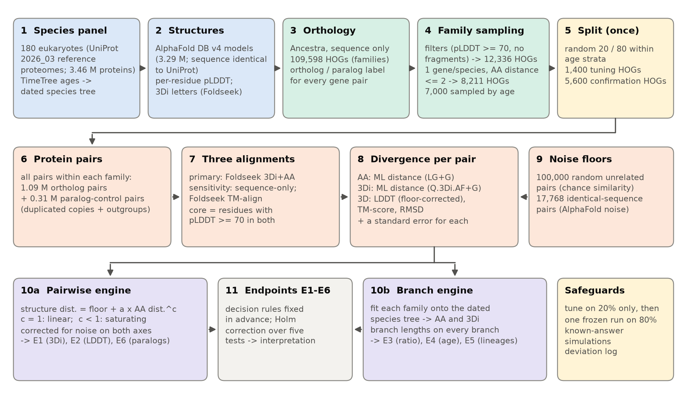

**Figure 1. Workflow.** Species panel and predicted structures (1–2) feed orthology inference (3). Families are filtered and sampled without looking at structure (4) and split once into tuning and confirmation sets (5). All pairs within each family (6) are aligned three ways (7) and scored for AA, 3Di and 3D divergence (8). Noise floors (9) come from random and identical-sequence pairs. Two estimation engines (10a, 10b) feed six pre-registered endpoints (11). Counts are from the filter logs.

### 3.1 Terms used throughout

| Term | Meaning |
|---|---|
| **Ortholog / paralog** | Genes separated by a speciation (e.g. the same gene in human and mouse) / by a gene duplication. An **out-paralog** duplicated before the speciation in question. |
| **HOG** | Hierarchical orthologous group: all genes descending from one ancestral gene at a given node of the species tree. "Family" means a top-level HOG. |
| **AA** | Amino acid (protein sequence). |
| **pLDDT** | AlphaFold's per-residue confidence (0–100); ≥ 70 usually means a reliable model. |
| **3Di** | Foldseek's 20-letter structural alphabet: each residue gets a letter describing its local 3D interaction with a neighbouring residue (van Kempen et al. 2024). |
| **TM-score / LDDT / RMSD** | Global superposition-based similarity, 0–1 (unrelated ≈ 0.2–0.3; Zhang & Skolnick 2004) / fraction of inter-residue distances preserved, 0–1 (Mariani et al. 2013) / root-mean-square atomic deviation (Å). |
| **Substitution model** | Rates at which each letter is replaced by each other letter: LG for amino acids (Le & Gascuel 2008), Q.3Di.AF for 3Di (Garg & Hochberg 2025). |
| **Γ rate variation** | Sites evolve at different speeds, modelled by a gamma distribution with shape α (small α = strong variation; Yang 1994). |
| **ML distance** | Maximum-likelihood estimate of substitutions per site between two sequences. Unlike the raw fraction of differing sites (p-distance), it corrects for repeated changes at one site. |
| **Branch length** | Change along one branch of a tree, in substitutions per site. A **terminal** branch leads to a single species; an **internal** branch joins two internal nodes. |
| **Divergence time** | Age of a split, in millions of years (My, or Mya for "ago"), from TimeTree (Kumar et al. 2022). |
| **η (noise floor)** | 3Di distance between two AlphaFold models of *identical* sequences: change measured when no evolution has happened (§3.6). |
| **k** | Sequence-to-structure rate ratio: AA branch length divided by 3Di branch length. k = 4 means AA changes four times faster than 3Di. |
| **c** | Curvature exponent of 3Di distance against AA distance: c = 1 linear, c < 1 levelling off (§3.7). |

### 3.2 Species panel and divergence times

**We chose 180 eukaryotes spanning the eukaryotic tree, nearly all of whose proteins have an AlphaFold model with an identical sequence** (Figure 2a).

Proteomes came from UniProt release 2026_03 (one canonical protein per gene; 3,460,494 proteins). A species was eligible if at least 80% of its proteins had an AFDB v4 model with exactly the same sequence, it passed BUSCO completeness thresholds (Manni et al. 2021; relaxed for protists), and it was datable in TimeTree. We took eligible Quest for Orthologs 2022 eukaryotes, 33 sister-species pairs (very young splits), one species per phylum, and a greedy fill for an even spread of split ages on a log scale: 66 animals, 40 fungi, 20 land plants and 54 species from all other supergroups. Rat, zebrafish, chicken and *Xenopus* are missing because their proteomes no longer match AFDB v4.

A separate panel of 100 prokaryotes (60 bacteria, 40 archaea; one Asgard archaeon, *Prometheoarchaeum syntrophicum* MK-D1) was used only for the cytoskeleton case study.

**Divergence times.** TimeTree (Kumar et al. 2022) supplied the topology (TimeTree-of-Life 2015) and pairwise ages (service version 20260820). 15,755 of 16,110 species pairs were dated; the undated ones mostly involve three metamonads and *Fonticula*. After pruning, internodes shorter than 5 My were collapsed into **polytomies** (nodes with more than two children), leaving 123 internal nodes, 117 of them dated. Ages were made monotone from root to tips (34 fixes, all deep), and the root is at 1,455 Mya.  Human–mouse = 83.5 Mya passed the plan's 87 ± 10 Mya check. A first version also collapsed nodes whose age intervals overlapped their parent's; this merged well-supported clades such as Opisthokonta into the root, so it was dropped before any family was built (D30).

Because 52% of dated pairs fall at the root age (Figure 2c), analyses work with tree branches, not pairs.

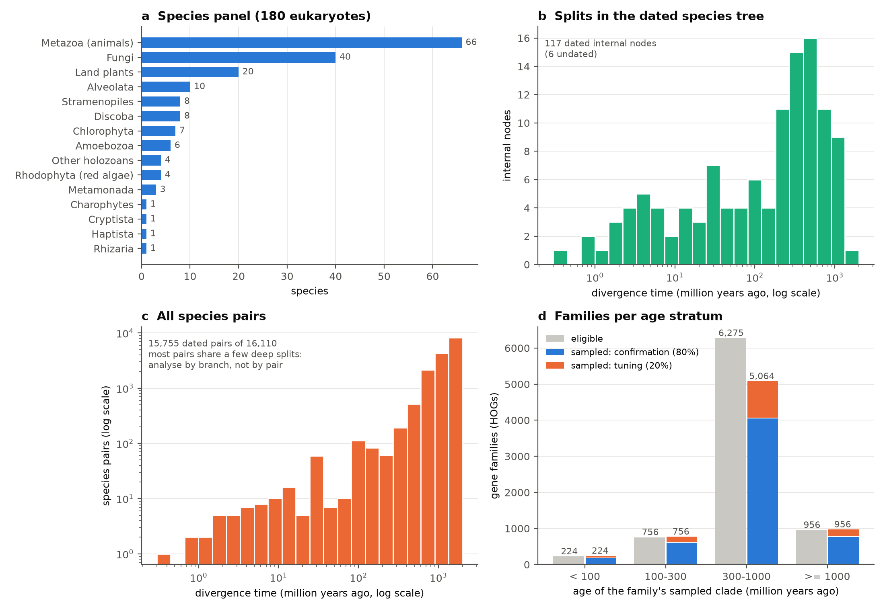

**Figure 2. Species panel.** (a) Species per group. (b) Ages of the 117 dated internal nodes. (c) Ages of all dated species pairs (log axes): most pairs share a few deep splits. (d) Families per age stratum; grey: eligible, coloured: sampled (confirmation 80%, tuning 20%).

### 3.3 Predicted structures and orthology

**Every analysed protein has an AlphaFold v4 model whose sequence is identical to the 2026 UniProt sequence, and orthology was inferred from sequence alone.**

**Structures.** Of the 3.46 M panel proteins, 3,290,300 (95.1%) have an AFDB v4 model, and 94.9% of all proteins match exactly. Models were read from the compressed FoldComp archive with zero failures. Proteins longer than 2,700 residues (16,160, e.g. titins and dyneins) have no model. We kept coordinates, per-residue pLDDT and the Foldseek 3Di string (Foldseek 10.941cd33).

**Orthology.** We used Ancestra (Ancestra 2026; commit ffb0bbe, `accurate` preset), a graph-based method that builds HOGs level by level up a guide tree (here the NCBI Taxonomy; Schoch et al. 2020). It uses DIAMOND searches, mutual best matches and small local gene trees; its optional structure-based step was left off. Ancestra is itself AI-generated output of the same hackathon, not verified by a human, so we checked it against Ensembl. It recovered 148 of 149 human–mouse one-to-one orthologs, and none of 187 sampled human–mouse ortholog calls was an Ensembl paralog. Its *timing* of duplications agreed with Ensembl for only about 36% of human paralog pairs, so we never use Ancestra's duplication ages (D2); paralog analyses instead match on sequence distance and use explicit outgroups. The run on 180 proteomes took 5.0 h (84 CPU-hours, 161 GB peak memory) and produced 109,598 top-level HOGs. Each gene pair within a HOG is labelled ortholog or paralog by the deepest group containing both.

### 3.4 Family sampling and the tuning/confirmation split

**Families were sampled using sequence information only, keeping one gene per species and avoiding families too diverged to measure.**

| Gene filter | Genes remaining | Families remaining |
|---|---|---|
| Input (genes in top-level HOGs) | 2,924,444 | 109,598 |
| Model sequence identical to UniProt | 2,761,752 | |
| Not a fragment | 2,624,408 | |
| Mean pLDDT ≥ 70 | 1,632,375 | 57,348 |
| Length 0.5–2× the family median | 1,521,329 | |
| ≥ 8 species with exactly one copy | | **12,336** |

The pLDDT filter removes 38% of genes and is the largest cut, so the analysis concerns well-predicted, mostly ordered proteins.

**One-to-one sets.** Within each family we keep only species with exactly one gene. This does not guarantee orthology: Ancestra labels 4% of these pairs as out-paralogs (hidden paralogy or differential gene loss). They are kept, flagged, and removed in a sensitivity analysis.

**Choosing species.** For each family we searched the species tree for the largest clade with at least 8 species in which every gene pair is at most 2 AA substitutions per site apart, keeping at most 30 species chosen to cover as many tree nodes as possible. The distance used here comes from a sequence-only alignment with fixed settings (α = 1, never re-tuned), so selection cannot depend on structure or on tuned parameters. The 2-substitution limit keeps every pair in the range where ML distances are reliable. 8,211 families qualified.

**Sampling and split.** Families were stratified by the age of their selected clade (< 100, 100–300, 300–1,000 and ≥ 1,000 Mya) and 7,000 were drawn with equal quotas, unused quota moving to other strata. Only 224 families were eligible in the youngest stratum, so the final sample is 224, 756, 5,064 and 956 (Figure 2d). Within strata, families were split at random (seed 20261030) into 1,400 tuning and 5,600 confirmation families.

**Pairs.** The primary set has all pairs within each family (1,087,063). The paralog control (endpoint E6) adds 36,500 duplication triplets in 12,808 paralog groups from 5,001 families (two paralogs in one species plus orthologs in outgroup species), giving 312,674 further pairs. Triplets were capped at 5 outgroup species per side and 5 triplets per paralog group (C25) to keep within a budget of 3.5 M pairs.

### 3.5 Divergence measures and the three alignments

**Each pair is aligned three ways, and amino-acid, 3Di and 3D divergence are computed from each alignment over the reliably predicted core.**

| Alignment | What it is | Role |
|---|---|---|
| **3Di+AA alignment** | Foldseek's default alignment, scoring 3Di and AA letters together | Primary |
| **Sequence-only** | Global BLOSUM62 alignment (Biopython; Cock et al. 2009), ignoring structure | Sensitivity |
| **TM-align** | Foldseek's TM-align mode, superimposing coordinates and ignoring letters | Sensitivity |

A conclusion is **alignment-robust** only if all three alignments agree on its sign and decision.

**Why the primary alignment changed (D22).** The design first chose TM-align, but a pilot run on a 20-species test set showed that it misaligns close relatives (for 5,295 human–mouse orthologs, median core AA p-distance 0.091 against 0.064 under the other two alignments, and a non-zero AA distance for 8 of 104 pairs of identical sequences), so the 3Di+AA alignment became primary.

**Core.** Distances use only aligned columns where both residues have pLDDT ≥ 70. A pair counts if it has at least 50 such columns and covers at least half of the shorter protein; failed pairs are counted and given zero weight, never silently dropped.

**Measures per pair.**
- **AA and 3Di distances:** ML distances under LG+Γ4 and Q.3Di.AF+Γ4, computed on a GPU from 20×20 counts of aligned letter pairs, with a standard error (SE) from the likelihood curvature. Γ shapes were tuned on the tuning set from the sequence-only alignment (α_AA = 1.64, α_3Di = 1.60; C29), because on the 3Di+AA alignment the 3Di shape ran to the edge of the search grid, an artefact of column placement optimised for 3Di.
- **Global LDDT, TM-score and core RMSD.** LDDT and TM saturate by construction, so LDDT is converted to a distance with a floor correction, D = −ln[(S − S₀)/(1 − S₀)], where S₀ is the chance similarity of unrelated proteins of that length (§3.6). This follows the corrections used by FoldTree (Moi et al. 2025).
- **SE calibration.** A block bootstrap over alignment columns on the tuning set gave SDs 1.0–1.6 times the model SEs; AA and 3Di errors for the same pair were correlated at 0.08–0.33, because both come from one alignment.

### 3.6 Noise floors

**Two reference sets show what "no relationship" and "no evolution" look like.**

- **Chance level.** 100,000 random pairs from different species, AFDB clusters and Pfam clans (Mistry et al. 2021) give S₀ in six length bins (median TM-score 0.22–0.33).
- **Zero divergence.** 17,768 pairs of different AFDB entries with *identical* sequences (almost all from different species) show how much two AlphaFold predictions of one sequence differ. They are not identical: median TM-score 0.950, only 8.8% reach TM ≥ 0.999, and median 3Di distance is **η = 0.052** substitutions per site, rising with length from 0.037 to 0.066. Median 1 − LDDT is 0.020.

This prediction noise is a floor under every structural distance. It enters the shape model as a fixed intercept η, and the branch model subtracts ν = η/2 from each terminal branch (each tip carries one model's share of the noise). Both choices turn out to matter (§4).

### 3.7 Two estimation engines

**One engine fits the shape of the structure-versus-sequence curve from pairwise distances; the other places each family's distances on the dated species tree.**

**Pairwise engine (shape; endpoints E1, E2, E6).** Within each family, each pair gives x = AA distance and y = 3Di distance (or floor-corrected LDDT distance). We fit y = η + a_h · x^c, with η the fixed noise floor, a_h a family-specific scale and c one curvature exponent shared by all families. Shape is estimated on whole pairwise distances because saturation shows up in total divergence, not in branch increments. Because x is measured with error, which flattens a fitted curve and makes a truly linear relation look concave, we corrected with **SIMEX** (simulation–extrapolation; Cook & Stefanski 1994): add known extra noise, track how the estimate drifts, and extrapolate back to zero noise. A parametric bootstrap then removes the bias that remains (D31, §3.9). Uncertainty comes from a bootstrap over families and species.

**Branch engine (ratio, time, lineages; endpoints E3, E4, E5).** Each pairwise distance is the length of the path between two tips of the family's (fixed, dated) species tree, so with many pairs the individual branch lengths can be solved for by weighted least squares. Doing this separately for AA and 3Di gives an AA length and a 3Di length for every branch of every family. Ratios on young and old branches show whether k changes with time; ratios on particular lineages show whether some lineages change structure faster than sequence. Fitting on the shared tree also handles the main non-independence among pairs (many share the same deep branches). Two safeguards: ratios are always ratios of sums over many branches, never of single short, noisy branches; and families whose distances fit their own sequence-based tree more than three times better than the species tree are excluded, as a guard against hidden paralogy and gene-tree discordance.

### 3.8 Endpoints and the pre-registered interpretation

**Six endpoints, each with a decision rule, were fixed before analysis.** E1, E2, E4, E5 and E6 are tested jointly with a Holm correction (Holm 1979) at 5% family-wise error; CI-based rules use 98% intervals. E3 is an estimate.

| Endpoint | Question | Decision rule |
|---|---|---|
| **E1** | Is 3Di divergence linear in AA divergence (c ≈ 1) or saturating (c < 1)? | "Linear" if the 98% CI of c lies in [0.9, 1.1]; "concave" if its upper bound is < 1; else inconclusive |
| **E2** | The same for floor-corrected LDDT distance; plus d*, the AA distance at which raw 1 − LDDT departs from a straight line by > 10% | As E1 |
| **E3** | k = total AA branch length / total 3Di branch length; its spread across families; α-helical vs β-sheet contrast | Estimate; compared with 3–10× |
| **E4** | Does the 3Di/AA ratio change with branch age? Slope β of log(3Di/AA) against log age, in a mixed model over **cells** (a family's branches grouped by age bin, merged until each carries enough information) | β = 0, two-sided |
| **E5** | Do lineages differ in their 3Di/AA ratio beyond noise? Slope of 3Di on AA change across sister lineages, and excess lineage SD σ_L | N0 accepted only if the slope's 98% CI lies in [0.8, 1.25], σ_L < 0.10, E6 detects the positive control, and power ≥ 80% |
| **E6** | Positive control: (a) do paralogs diverge more in 3Di than orthologs at matched AA distance; (b) does the more-diverged copy after duplication diverge more in 3Di? | One-sided > 0 |

Note the sign convention: a *negative* β in E4 means the AA:3Di ratio k *rises* with age.

**E6 design.** Adapting Warwick Vesztrocy et al. (2025), the more-diverged copy (MDO) after a duplication is chosen with one set of outgroups and one half of the alignment columns (alternating 20-residue blocks); its structural excess over its sister, the least-diverged ortholog (LDO), is measured with a different outgroup set on the other half. This prevents regression to the mean.

**Interpretation table, in plain words** (written before any result; used only if E5 power ≥ 80%):

| If E1/E2 say | and E4 says | and E5 says | we conclude |
|---|---|---|---|
| linear | no age trend | N0 margins met | Structure follows a rescaled sequence clock ("proportional", not "neutral": a good fit does not prove neutrality) |
| concave | k rises with age | N0 met | Structure saturates, or AA distances are under-corrected; clock-like only up to d* |
| linear | k rises with age, robust to α and deep ages | any | Epoch effect: deep branches structurally more conservative |
| any | k falls with age | any | AA under-correction or early structural bursts |
| any | any | slope < 0.8 or excess lineage variance, robust to guards | Lineage-specific structural rates; N0 rejected |
| any | any | excess not robust to guards | AlphaFold-quality or orthology artefact ("artefact suspect") |

The design removed the reading "a rising ratio means constraint", because constraint slows both alphabets.

**Known limitation, stated before the results.** Simulations showed that E5's slope CI is about ±0.24–0.28 wide even when N0 is exactly true, so *accepting* N0 within [0.8, 1.25] is practically unreachable. The margins were not widened; E5 can still reject N0, but otherwise reports "inconclusive".

### 3.9 Controls and verification

**Every estimator was checked on simulated data with a known answer, and the main sources of bias have explicit controls.**

**Known-answer tests.**
- **Distances and pipeline.** On data simulated with AliSim (Ly-Trong et al. 2022), ML distances were unbiased within 1.6% up to distance 2 and matched IQ-TREE within 0.004% (33 automated tests). Pipeline invariants held (e.g. a protein against itself scores TM = LDDT = 1).
- **Branch engine.** Known branch lengths were recovered without bias; model-based SEs gave 96% coverage of 95% intervals.
- **Curvature (D31).** In simulations on the real tuning designs with calibrated noise, the planned SIMEX estimator returned c ≈ 0.95 under a truly linear relation, a false "concave" call. With the D31 bias correction, c = 0.993, 0 of 50 linear datasets were called concave, and true curvature was recovered (c = 0.8 → 0.788).
- **Age slope (D32).** In worlds with no age effect, the planned cell construction gave a spurious slope (+0.058, false-positive rate 20%) driven by noise on young terminal branches. A minimum-information rule for merging cells (D32) reduced this to −0.0075 with no false positives and recovered true effects (−0.1 → −0.100).
- **End to end.** Synthetic N0 families passed through the whole pipeline recovered the truth, and a lineage "spike" was detected.

**Controls on real data.**
- **Positive control:** E6.
- **Negative control for E4: permuted ages (D13).** Branch midpoint ages are shuffled among a family's branches, so no age signal should remain. On the real tuning set, as the plan specified, all 20 permutations gave 98% CIs covering zero in both tuning dry runs. In synthetic worlds *with* a true age effect, the D32 cell rule lets some true signal leak into the permuted fits (11 of 20 CIs cover zero; mean permuted β −0.013 against −0.077 with true ages), so the criterion for that check was redefined as a leak below 20% of the true effect (C34), with both criteria reported. The control was not re-run on the confirmation set. By design it cannot detect the terminal-branch artefact described in §4.3, because shuffling ages also breaks the link between "terminal" and "young".
- **E5 power:** a 1.5-fold 3Di acceleration spiked into 10% of lineages in the tuning families, 50 replicates.
- **Sensitivity analyses:** the other two alignments; α × 1.5 and ÷ 1.5; AA distance ≤ 1; removal of hidden-paralogy pairs; single-copy families only; internal branches only; and alternative deep-node ages from Strassert et al. (2021) and Betts et al. (2018).

**Exploratory analyses (unadjusted CIs).** Ortholog pairs with X-ray structures on both sides compare AF–AF with PDB–PDB divergence; pairs from inside AFDB clusters show the effect of structural pre-selection. The cluster audit maps every HOG onto AFDB v3 clusters and models why HOGs split, using length ratio, AA distance, pLDDT and change in TED domain architecture (Lau et al. 2024). The case studies estimate AA and 3Di branch lengths for actin- and tubulin-fold proteins (eukaryotes plus the prokaryote panel) and for protein kinases, on fixed reference trees with IQ-TREE 3 (Wong et al. 2026), comparing MAFFT (Katoh & Standley 2013), FAMSA (Deorowicz et al. 2016) and structure-guided FoldMason alignments (Gilchrist, Mirdita & Steinegger 2026).

---

## 4 Results: Goal 1, is structure a molecular clock?

**Main point.** The pre-registered analysis concluded that 3Di structure saturates relative to sequence, changes about 3.3 times more slowly than sequence, and is relatively slower on older branches. A post-hoc review traced most of this to one source: an extra per-protein offset, most plausibly AlphaFold model noise, that the fixed noise floor did not remove. Allowing for it, structure follows sequence at a roughly constant ratio of about 4.6 on internal branches. Each subsection reports the pre-registered result unchanged, then the post-hoc interpretation, labelled as such.

**What ran.** The single confirmation run passed all ten integrity guards. 4,891 of the 5,600 confirmation families entered the branch endpoints; the others failed the misfit screen (510), had too many failed pairs (183) or had trees that could not be solved (195), with overlaps. Holm-adjusted p-values for E1, E2, E4, E5 and E6 were all below 10⁻⁴. The interpretation-table row that applies is **"artefact suspect"**, used only descriptively because E5's power condition (≥ 80%) was not met (power 0.24).

| Endpoint | Pre-registered result (confirmation set) | Decision |
|---|---|---|
| E1 3Di vs AA shape | ĉ = 0.72 [98% CI 0.64, 0.80] | concave |
| E2 LDDT distance vs AA shape | ĉ = 0.70 [0.61, 0.79] | concave |
| E3 ratio k = ΣAA/Σ3Di | 3.32 [3.09, 3.57] | estimate |
| E4 ratio vs branch age | β = −0.150 [−0.200, −0.101] | k rises with age |
| E5 lineage effects | slope 0.57 [0.10, 1.05]; excess lineage SD 0.31 | artefact suspect |
| E6 duplication control | (a) 0.030 [0.026, 0.033]; (b) 0.017 [0.012, 0.022] | detected |

### 4.1 Shape: concave by the pre-registered test, but the test is sensitive to an unmodelled per-protein offset

**Pre-registered result (E1, E2).** 3Di distance grows more slowly than AA distance: **ĉ = 0.723 [0.642, 0.803]**, from 591,410 pairs in 4,850 families (Figure 3a). The naive fit gave 0.670, SIMEX raised it to 0.717 and the simulation-based bias correction (§3.9) added 0.006. The decision is "concave" under all three alignments (sequence-only 0.80 [0.70, 0.90]; TM-align 0.80 [0.72, 0.89]) and in every planned sensitivity (range 0.54–0.75; e.g. AA distance ≤ 1: 0.66). For floor-corrected LDDT distance (E2), ĉ = 0.70 [0.61, 0.79] (sequence-only 0.72, TM-align 0.32), and d* fell at the lowest grid value (0.05): there is no initial linear range. In simulations on the real tuning designs, a linear world was never called concave (0/50; mean ĉ 1.03), but power was low: a true c = 0.90 was detected only 55% of the time.

**Post-hoc finding: the fixed floor makes the estimator lean concave.** The model assumes that two AlphaFold models of orthologs differ by one global amount, η = 0.052 (the identical-sequence median), before any evolution. Non-identical orthologs carry more: about 0.010 3Di substitutions per site per protein pairwise, and 0.013–0.017 per terminal branch. About half of this excess appears with the very first substitutions; the rest builds up by AA distance ≈ 0.1. It tracks model confidence: estimated per-protein effects fall from 0.034 to 0.020 across pLDDT quintiles, mirroring the identical-sequence floor (0.031 → 0.020).

An extra offset at the low end of the curve, with a fixed intercept, is exactly what bends a power-law fit downwards. Two checks support this:
- **Real data.** Giving each family its own baseline (η_h) raises the naive ĉ from 0.67 to 0.90 (AA distance 0.05–2), 0.94 (0.05–1) or 0.98 (0.3–2).
- **Synthetic data.** On the real design with realistic per-protein offsets, the fixed-η estimator turned a true c = 1 into 0.75–0.78, while the family-baseline estimator stayed near the truth (0.92–0.98).

The verifying agent also found counter-evidence: a model with one effect per protein, which fits far better, puts ĉ back at 0.73–0.75, although that model is itself biased low in synthetic worlds (a true c = 1 returned as 0.75–0.94). No single synthetic world reproduces all three estimators, so the pairwise data **bracket c at roughly 0.75–1.0** without pinning it.

**What we conclude.** *Shown:* the pre-registered ĉ = 0.72 is not robust to how the zero-divergence baseline is specified. *Not shown:* that structure saturates. Saturation should worsen with distance, yet the curve is *more* concave at short distances (0.66 for AA distance ≤ 1), and the branch-level evidence (§4.3) points to near-proportionality. The step at small distances could be AlphaFold noise for non-identical sequences or a real, quickly saturating structural component; the data cannot tell them apart.

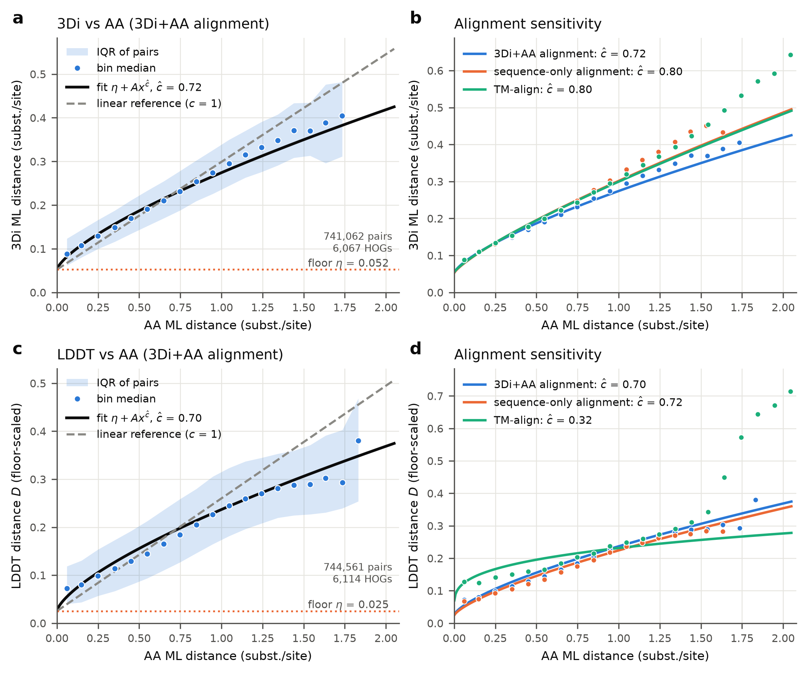

**Figure 3. In the pre-registered fit, structural divergence rises more slowly than sequence divergence, but the curve is close to a straight line plus an offset.** One-to-one ortholog pairs from the tuning and confirmation sets together (741,062 pairs in 6,067 families for 3Di; 744,561 pairs in 6,114 families for LDDT), more than the 4,850 confirmation families of the pre-registered fit. **(a)** 3Di against AA ML distance: medians in 0.1-wide bins with interquartile range (IQR). Black: ĉ = 0.72; grey dashed: linear; orange dotted: η = 0.052. **(b)** The three alignments. **(c, d)** As (a, b) for floor-corrected LDDT distance. Curves are overlays, not refits. Most visible concavity lies below AA distance 0.25, where the extra per-protein offset is largest. Under TM-align the medians bend upward at large distances (beyond AA distance 1.5 for 3Di and 1.3 for LDDT), so its LDDT ĉ of 0.32 is not a robust shape.

**Post hoc check in high-confidence models.** If the offset is AlphaFold noise, it should shrink in confidently predicted proteins and the pre-registered estimator should move toward linear there. Restricting to pairs where both models have mean pLDDT ≥ 90, the offset above the noise floor halves (0.019 → 0.009 substitutions per site) and the pre-registered estimator gives ĉ = 0.85 naive / 0.94 after measurement-error correction (vs 0.67 / 0.72 on all pairs); the family-baseline estimator stays at about 0.90. With a noise floor matched to high-confidence identical-sequence pairs, however, ĉ is 0.76 / 0.84 and an offset of 0.015 remains. The direction matches the noise explanation, but the data still only bracket the curvature at about 0.75–1.0.

### 4.2 Conservation ratio: sequence changes about 3.3× (pre-registered) to 4.6× (internal branches, post hoc) faster than 3Di

**Pre-registered result (E3).** Summed over all branches of all family trees, **k = 3.32 [98% CI 3.09, 3.57]** (sequence-only 3.06, TM-align 3.08), overlapping Illergård et al.'s "3–10×" (Figure 4). Breakdowns:
- **Fold class.** α-helical families k = 4.68 and β-rich families k = 2.55 (CATH classes from TED; n = 1,336 and 696 families); difference in log k 0.61 [95% CI 0.53, 0.68], unadjusted. *Post hoc check:* on internal branches only, the contrast persists but shrinks: k_α = 6.11 [5.94, 6.31] vs k_β = 3.85 [3.74, 3.97], a ratio of 1.59 [1.52, 1.65] (vs 1.83 on all branches). Mean pLDDT is similar in the two classes (80.5 vs 81.8), and the internal-branch ratio stays at 1.5–1.7 within pLDDT tertiles, so the terminal-branch artefact explains at most a small part of the contrast. β-rich proteins change their 3Di states faster per substitution, the same direction Illergård et al. (2009) found for secondary structure, which was the only fold-class trend they reported as significant.
- **Length and confidence.** k is slightly higher for short proteins (length tertiles 3.72, 3.22, 3.16) and for the most confidently predicted families (pLDDT tertiles 3.16, 3.14, 3.57).
- **Age.** k rises with the age of the family's sampled clade, from 2.26 (< 100 Mya) to 3.74 (≥ 1,000 Mya).

The plan's estimate of the between-family spread, σ_k (SD of log k), came out at 0 (variance −0.41).

**Post-hoc interpretation.**
1. **The rise of k with age is the tip artefact of §4.1.** The extra per-model noise sits on terminal branches, which make up most of the young families. On internal branches alone k does not change across strata (3.74, 4.71, 4.63, 4.65), whereas terminal-branch k rises from 1.54 to 3.53.
2. **σ_k = 0 is an estimator failure, not homogeneity.** The plan subtracted the *mean* sampling variance, which a few imprecise families dominate (mean 0.82 against a median of 0.0039). Robust estimators of the SD of log k give about 0.32 (DerSimonian & Laird 1986), 0.47 among precisely estimated families (whose k spans 1.7–5.2 from the 10th to the 90th percentile) and about 0.25 on internal branches. Families therefore differ about two- to threefold, smaller than but in the spirit of Illergård's fivefold variation.
3. **Internal-branch k = 4.63 [4.35, 4.93]** is free of the tip correction and is our best central value. It was a planned sensitivity, but choosing it as the headline is a post-hoc decision. In plain terms: for every 4–5 amino-acid substitutions per site, about one residue's 3Di letter (its local 3D-contact state) changes.

**Comparison with Illergård et al. (2009).** Both 3.3 and 4.6 lie inside "3–10×". The alphabets are matched, but 3Di describes local tertiary contacts rather than secondary structure, accessibility or RMSD, our structures are predictions, and our families are eukaryotic orthologs rather than SCOP domain pairs. A ratio from experimental structures could differ in either direction (§4.5); we did not measure it.

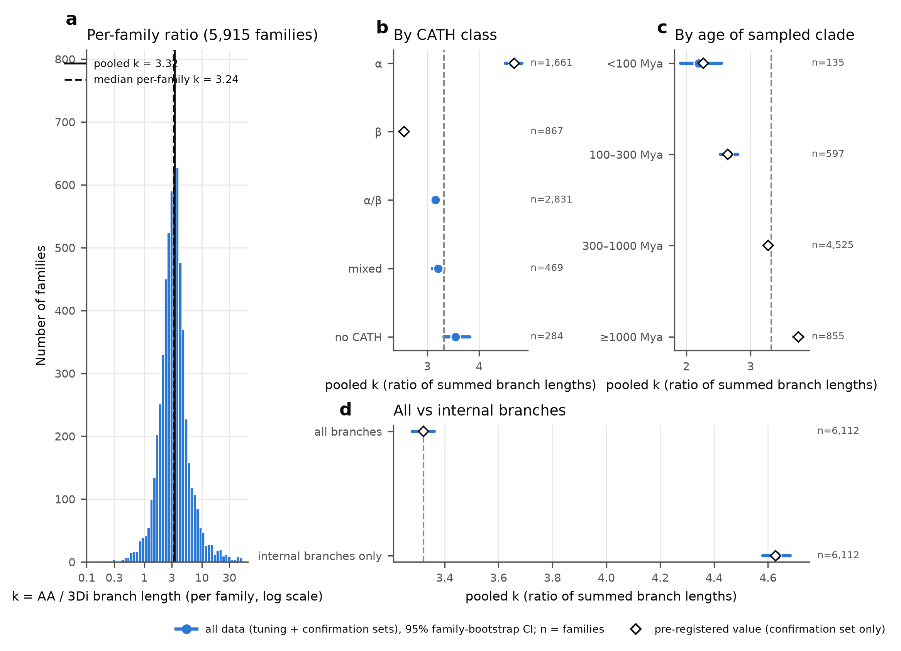

**Figure 4. Sequence changes 3–5 times faster than 3Di structure, more so in α-helical than in β-rich families.** **(a)** Per-family k for 5,915 families (median 3.24, IQR 2.38–4.34). **(b–d)** Pooled k on all data (tuning and confirmation sets) with 95% family-bootstrap CIs; n is the number of families per group in all data, so it is larger than the confirmation-only counts in the text (e.g. α 1,661 and β 867 here against 1,336 and 696). Open diamonds: pre-registered confirmatory values. (b) By CATH class: α 4.67, α/β 3.16, mixed 3.21, β 2.55. (c) By age of the family's sampled clade: 2.19 to 3.74, a trend that disappears on internal branches. (d) All branches 3.32, internal branches 4.63.

### 4.3 Time: the pre-registered age trend is real in the data, but it is carried by terminal branches

**Pre-registered result (E4).** The log ratio of 3Di to AA change falls with log branch age, **β = −0.150 [98% CI −0.200, −0.101]**, Holm p = 2.6 × 10⁻¹²; that is, k rises with age. All required robustness checks keep sign and significance: α × 1.5 −0.138; α ÷ 1.5 −0.167; deep-node ages from Strassert et al. (2021) −0.142 and Betts et al. (2018) −0.150; sequence-only −0.110; TM-align −0.151. Calibration simulations showed that the estimator recovers only about 46% of a true slope. However, the plan had named **internal branches only** as *the* key robustness check, and there β = −0.047 [−0.128, 0.034] (p = 0.18); a weighted least-squares version with family-clustered errors also gave −0.034 [−0.111, 0.044].

**Post-hoc interpretation: the trend is mostly a tip-correction artefact.** Terminal branches get a fixed subtraction ν = η/2 = 0.026. If the true per-model offset is larger, the young terminal branches, which are short in AA, keep too much 3Di length, their ratio looks low, and β is pushed negative (Figure 5). Four lines of evidence support this:

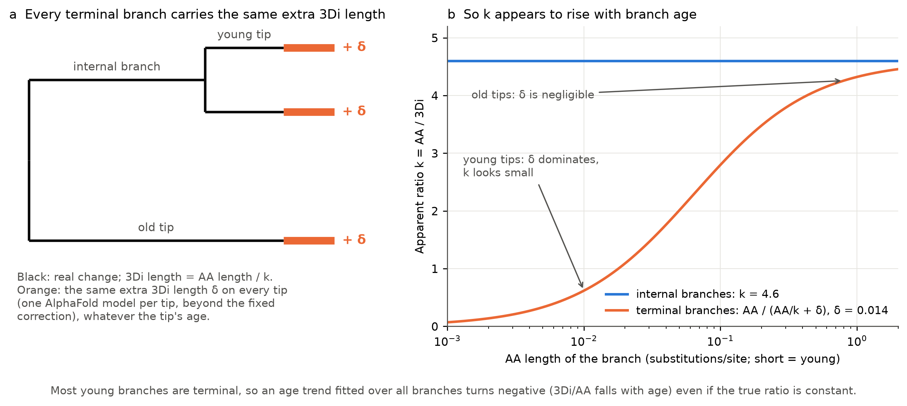

**Figure 5. Why a fixed extra 3Di length on terminal branches makes the ratio appear to rise with age (schematic).** **(a)** Each terminal branch (tip) ends in one AlphaFold model, so if every model adds the same extra 3Di length δ beyond the fixed correction, every tip carries +δ regardless of its age; internal branches carry none. **(b)** Apparent k = AA/3Di for a branch whose true ratio is 4.6. On internal branches it stays at 4.6 (blue). On terminal branches it is AA/(AA/4.6 + δ) (orange): on short, young tips δ dominates and k looks small; on long, old tips δ is negligible. Because young branches are mostly terminal, the age slope fitted over all branches turns negative. Illustrative values: k = 4.6 (internal-branch estimate) and δ = 0.014 (the per-tip excess that reproduces the observed pattern in simulation, point 4 below); no data are plotted.

1. **Branch-type decomposition** (confirmation set; Figure 6). k on internal branches is flat from 30 My on; terminal k climbs from below 1, i.e. more 3Di than AA change, which is implausible for real evolution.

   | Branch midpoint age (My) | < 30 | 30–100 | 100–300 | 300–1,000 | > 1,000 |
   |---|---|---|---|---|---|
   | k, internal branches | 3.13 | 4.47 | 4.63 | 4.94 | 4.68 |
   | k, terminal branches | 0.73 | 2.61 | 3.57 | 4.16 | – |

2. **The terminal-branch excess is roughly constant per branch** (0.014, 0.017, 0.013, 0.008 across age bins), as an additive per-tip artefact predicts.
3. **β depends strongly on ν.** The pre-specified ν ± 0.005 sensitivity was missing from the confirmation output and was computed afterwards by an independent agent (logged as a post-confirmation deviation): ν − 0.005 gives β = −0.213 [−0.264, −0.162], ν + 0.005 gives −0.080 [−0.133, −0.027]. The sign holds within the pre-specified range, but β moves about twice as much as anticipated and reaches zero at ν ≈ 0.036. That value is plausible: the mean (not median) identical-pair floor gives ν = 0.031, and the ν that equalises terminal and internal k is 0.040.

   | ν (tip correction) | 0 | 0.013 | 0.021 | **0.026 (plan)** | 0.031 | 0.035 | 0.040 | 0.045 |
   |---|---|---|---|---|---|---|---|---|
   | E4 β | −0.352 | −0.291 | −0.213 | **−0.150** | −0.080 | −0.014 | +0.082 | +0.168 |

   Above ν ≈ 0.045, 12–20% of cells are **censored** (their summed 3Di length is zero or negative after the tip correction, so the plan sets it to a small fixed value) and β is unreliable. The internal-only β does not depend on ν.
4. **Simulated worlds** on the real design: true curvature c = 0.72 reproduces the all-branch β (−0.149) but predicts an internal-only β of −0.138, outside the observed CI; a linear world with 0.014 extra per tip reproduces the all-branch β (−0.134), the flat internal k and the youngest terminal k (0.71).

A node-based view is consistent with this (Figure 7). Over nodes aged 10–1,000 Mya, floor-corrected 3Di distance grows roughly with the square root of time (log–log slope 0.46) while AA distance grows somewhat more slowly than time (0.85); below 30 My the corrected 3Di distance even exceeds the AA distance, as expected if the per-model offset exceeds η in young comparisons (§4.3), although the figure does not show this directly.

**What we conclude.** *Shown:* the pre-registered age trend exists in the data and survives every pre-specified check, including ν ± 0.005. *Believed:* it is mostly residual AlphaFold noise on terminal branches. On internal branches, k is constant at about 4.5–4.9 from 30 My to over 1 billion years; any residual age trend is ≤ 0.05 in β (internal SE ≈ 0.035).

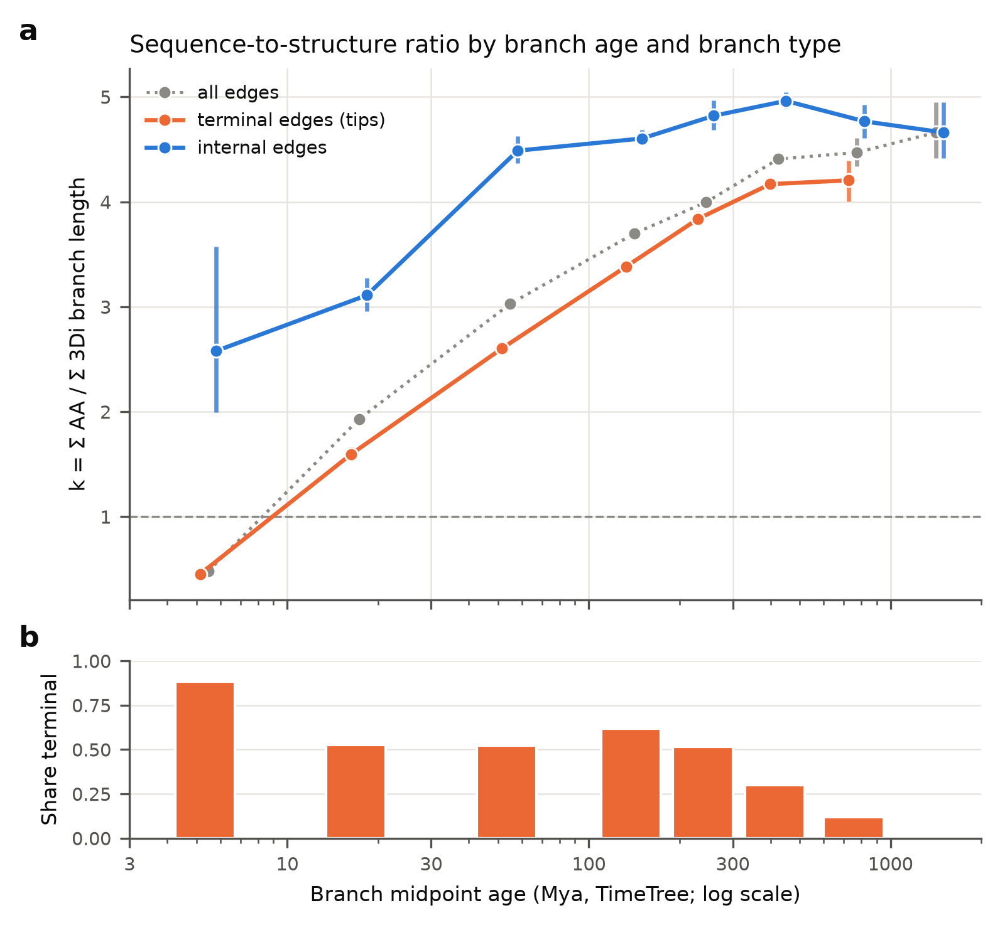

**Figure 6. The age trend in the sequence-to-structure ratio is carried by terminal branches.** **(a)** Pooled k against branch midpoint age (95% family-bootstrap CIs) for terminal, internal and all branches: terminal k rises from 0.46 (< 10 My) to about 4.2; internal k is about 4.5–5.0 from 30 My on. **(b)** Share of terminal branches per age bin (88% below 10 My). All 6,112 families passing the branch exclusions.

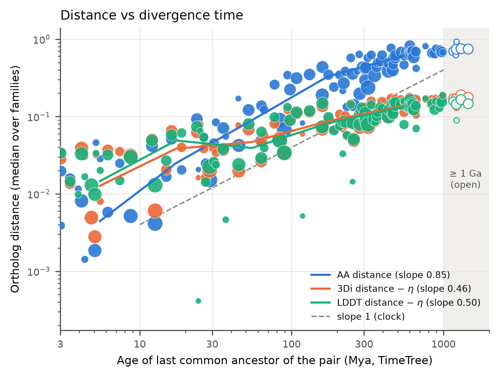

**Figure 7. Against time, sequence distance grows almost linearly and noise-floor-corrected structural distance grows more slowly.** Median ortholog distance against the age of the pair's last common ancestor (log axes) for 117 panel nodes; point size reflects the number of families. Blue: AA distance; orange: 3Di distance minus η; green: LDDT distance minus η; dashed: slope 1 (distance proportional to time). Slopes over 10–1,000 Mya: AA 0.85, 3Di 0.46, LDDT 0.50. Open symbols: nodes ≥ 1,000 Mya, excluded from the slopes. The flattening of the structural curves at young ages is consistent with extra per-model noise in young comparisons (§4.3), but this figure does not separate the two.

### 4.4 Lineages and the neutral clock: no evidence for lineage-specific structural rates on internal branches, at low power

**Pre-registered result (E5).** Across 162 lineages and 146 sister-lineage contrasts, the excess lineage SD departs from N0 (σ_L = 0.31; N0 needs < 0.10); the slope of 3Di on AA change, 0.57 [98% CI 0.10, 1.05], is too imprecise either to meet or to reject the N0 margin of 0.8–1.25 (probability-based rejection of slope < 0.8: p = 0.13). The pre-registered guards rerun the test without the parts most exposed to artefacts. On internal branches only, the excess disappears (slope 1.06 [0.79, 1.34]; excess variance CI [−0.022, 0.117]). In single-copy families the test is uninformative (slope CI [−25.9, 26.6]; point excess variance 0.095, about the same as the full-data 0.098), and the excess persists when hidden-paralogy pairs are removed. Because the excess is not robust to the guards, the plan classes it **"artefact suspect"**, not "lineage-specific rates"; this classification rests mainly on the internal-branch guard.

**Power.** A 1.5-fold 3Di acceleration spiked into 10% of lineages was detected in only 24% of tuning replicates, with a null rejection rate of 18%, far below the required 80%.

**What can be said.** *Shown:* no evidence of structure-specific lineage rates on internal branches; the apparent excess sits on species-level terminal branches, where the per-model artefact lives. *Not shown:* that N0 holds. This is absence of evidence from a test that would miss a 1.5-fold effect three times in four. Neutrality in the population-genetic sense was not tested: a constant ratio is equally expected if selection constrains both alphabets proportionally.

### 4.5 Two bias checks: AlphaFold compresses ortholog divergence, and in-cluster pairs describe a different range (exploratory)

**AlphaFold versus experimental structures.** Ortholog pairs with X-ray structures on both sides, released after AlphaFold2's training cutoff, look **30–40% more similar as AF models than as crystal structures** on the same residues (Figure 8; all five measures in Figure S1; 197 pairs in 160 families, 87 human–mouse; median AA distance 0.29). Mean AF divergence relative to PDB divergence [95% CI] is 0.59 [0.52, 0.66] for 3Di, 0.70 [0.62, 0.76] for 1 − LDDT, 0.69 [0.60, 0.78] for 1 − TM and 0.62 [0.51, 0.75] for core RMSD, with the same conclusions under TM-align, for pre-cutoff chains and on tuning-set families only.
- **It is mostly a constant offset.** AF divergence rises with AA distance at least as fast as PDB divergence (3Di slope ratio 1.34 [1.15, 1.57]), so AlphaFold does not flatten the curve; it removes an additive, noise-like component present in experimental pairs.
- **Same-protein floor.** An AF model differs from its own crystal structure by a median 3Di distance of 0.241, more than two AF models of different orthologs (0.167), consistent with experimental and conformational variation plus AlphaFold "idealisation" rather than lost evolutionary signal.
- **Limits.** The sample is small and shallow (about 10% of pairs beyond AA distance 2); pre-cutoff chains show a slightly larger AF–PDB gap (+0.050 [0.015, 0.087]), consistent with mild memorisation but confounded; and 118 of the 197 pairs belong to confirmation families (logged as a deviation; no tuning value used them).

**Selection effect of in-cluster pairs.** The 27.7 M member-to-representative pairs released with the AFDB clusters lie in a different, structurally pre-filtered identity range from orthologs (Figure 9). Their median sequence identity is 0.21 (4.4% ≥ 0.5), whereas our orthologs span 0.47–0.99 (5th–95th percentile). Inside clusters, median TM-score rises to about 35% identity and then plateaus at about 0.83, mainly a prediction-quality ceiling (at identity ≥ 0.6, median TM 0.58 for representatives with pLDDT < 60 against 0.97 for pLDDT ≥ 90). Low-identity cluster pairs still have median TM 0.66 at 21% identity because membership required structural similarity. Only 43.6% of the released alignments meet the nominal clustering filters, so the sample is a mixture, not a clean truncation. Because the two sets barely overlap, Figure 9 shows *that* in-cluster curves describe another population, not *how much* selection distorts a given curve.

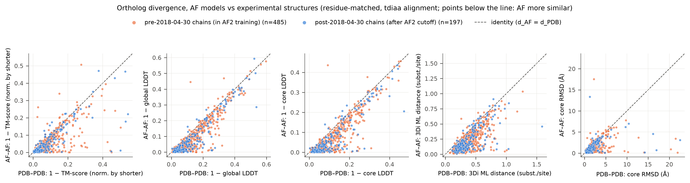

**Figure 8. AlphaFold models make orthologs look more similar than their experimental structures do, by a roughly constant offset.** Each point is one ortholog pair with X-ray structures on both sides: x = divergence between the two crystal structures, y = divergence between the two AlphaFold models on exactly the same residues (3Di+AA alignment). **(a)** 3Di distance. **(b)** 1 − global LDDT. Blue: chains released after AlphaFold2's training cutoff (197 pairs, primary set); orange: earlier chains (484–485 pairs). Points below the dashed line mean the AF models are more similar than the crystal structures. TM-score, core LDDT and core RMSD are in Figure S1.

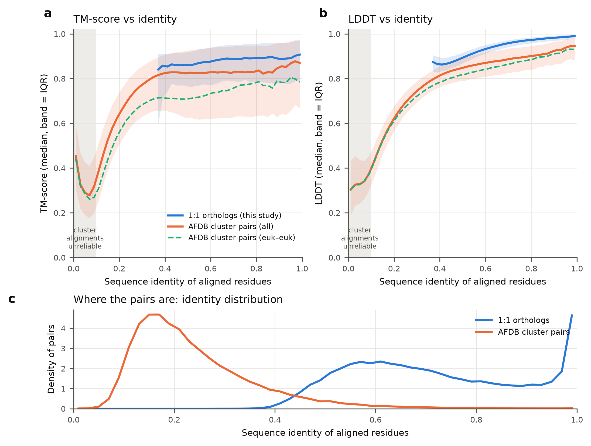

**Figure 9. Pairs from inside AFDB clusters lie in a different identity range from orthologs, and their low-identity end looks conserved because it was selected for structural similarity.** Median similarity (IQR bands) against sequence identity. Blue: one-to-one orthologs (873,628 pairs); orange: AFDB member-to-representative pairs (27.7 M; green dashed: eukaryote–eukaryote). **(a)** TM-score. **(b)** LDDT. **(c)** Identity distributions. Grey zone: cluster alignments below 10% identity are short or spurious. TM normalisation differs between sets (shorter protein vs alignment length).

---

## 5 Results: Goal 2, AFDB clusters in the light of evolution

**Main point.** Duplication leaves a measurable structural signature: the faster-evolving copy changes more in structure, replicating the direction of Warwick Vesztrocy et al. (2025), though the effect is comparable in size to AlphaFold noise. AFDB structural clusters are not orthology units: mostly because of length differences, they split and merge ortholog groups. Neither the cytoskeletal folds nor protein kinases showed a robust "structural burst" on any lineage.

### 5.1 Duplication (E6): detected, but only the more-diverged-copy effect is robust to alignment

**E6a: paralogs vs orthologs.** At matched AA distance, paralogs diverge more in 3Di than orthologs by **0.030 3Di substitutions per site [98% CI 0.026, 0.033]** (8,969 paralog groups in 3,525 families; pre-registered decision "detected"; the Holm-adjusted p-value is reported as 0, i.e. below numerical precision). It is **not alignment-robust**: −0.011 [−0.024, 0.002] under the sequence-only alignment and 0.027 [0.003, 0.051] under TM-align. Post hoc, E6a also compares paralogs with the fixed-η reference curve of E1, which §4.1 shows is misspecified. We therefore do not claim E6a.

**E6b: the more-diverged copy.** After a duplication, the copy with the longer AA branch (MDO) has **0.017 [0.012, 0.022]** more 3Di divergence than its sister (LDO) (6,027 groups), measured on outgroups and columns independent of those used to choose it. The effect is positive under all three alignments (0.017, 0.032, 0.032) and with LDDT distance (0.035 [0.029, 0.040]). This **replicates the direction** of Warwick Vesztrocy et al. (2025), who, using PANTHER gene trees and AFDB models, found lower LDDT for the MDO than the LDO in asymmetric duplications (median 0.723 vs 0.766), here with independent orthology, a different structural measure and a split-half design.

**Caveat (post hoc).** The E6b effect (0.017–0.035) is the same size as the per-model AlphaFold excess (§4.1). An MDO with lower pLDDT or a shallower input alignment would produce it without real structural change. A post-hoc adjustment for pLDDT differences between copies (regression of the excess on the pLDDT difference) halves the effect to 0.011 [0.0066, 0.0145]; among copies whose pLDDT differs by less than 2 it is 0.0093 [0.0067, 0.012]. The direction therefore survives, but its biological size is uncertain (pLDDT may itself partly reflect real divergence, so the adjusted value is a conservative lower range).

### 5.2 AFDB clusters vs orthology: clusters split and merge ortholog groups, mainly by length

**Mapping** (71,961 HOGs with at least two members in non-singleton AFDB v3 clusters; Figure 10). **70%** of these HOGs span more than one cluster, and on average only 36% of a HOG's members are in its largest cluster; splitting grows with HOG size, from 42% of two-member HOGs to 100% above 50 members. Conversely, **48.5%** of clusters with ≥ 2 panel members contain more than one HOG. 61% of HOGs, holding 94% of members, are both split and merged; only 14% map one-to-one.

**Why HOGs split.** A logistic model on 279,196 within-HOG pairs (48,130 HOGs; McFadden R² 0.40, AUC 0.90) finds splitting driven by length difference (log-odds 4.06 per SD of |log length ratio|; R² 0.31 alone) and AA divergence (1.17 per SD; R² 0.20 alone). A change in CATH domain architecture adds nothing once length is included (0.02, CI includes 0; Figure 11). This is what the 90% bidirectional-coverage rule of Foldseek clustering predicts: a domain gain or loss separates proteins through the length change it causes. Part of the length-driven splitting may instead reflect errors in Ancestra's orthology, which was not verified at this level: gene fusions, fragments or wrongly merged groups would also appear as large length differences within a HOG.

**Cluster ages are not orthology ages.** The cluster LCA coincides with the root of the dominant HOG for only **26.9%** of clusters (50.7% consistent once censoring is counted). Splitting makes cluster LCAs too young (within our panel, 70% are younger than the HOG root), while merging and taxa outside the panel make them too old.

**Domain architecture over time.** Even nearly identical orthologs differ in TED/CATH architecture 21–25% of the time (annotation noise), and architecture change is flat with time (0.24 below 100 Mya, 0.22 above 1,000 Mya), whereas cluster membership separates sharply (14% of ortholog pairs younger than 100 My in different clusters, 56% at 700–1,000 My). At matched AA distance, paralogs change architecture more often than orthologs (log-odds +0.23 [0.20, 0.26]). These analyses are exploratory (unadjusted 95% CIs). The split model and the paralog–ortholog architecture contrast use within-HOG pairs drawn from all HOGs (279,196 and 212,502 pairs); only the analyses against time (annotation floor, architecture change and cluster separation by age) use the 178,593 one-to-one ortholog pairs of the 1,400 tuning-set families.

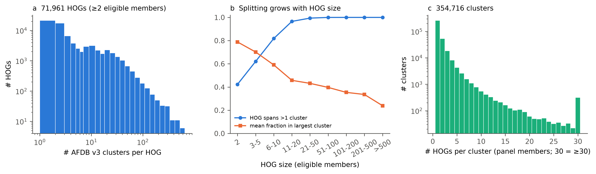

**Figure 10. AFDB structural clusters cut across ortholog groups in both directions.** **(a)** Number of AFDB v3 clusters per HOG, for 71,961 HOGs with ≥ 2 eligible members (log axes); 70% span more than one cluster. **(b)** Splitting grows with HOG size. Blue: fraction of HOGs spanning > 1 cluster; orange: mean fraction of members in the largest cluster. **(c)** Number of HOGs per cluster for 354,716 clusters (last bar ≥ 30); 48.5% of multi-member clusters contain more than one HOG.

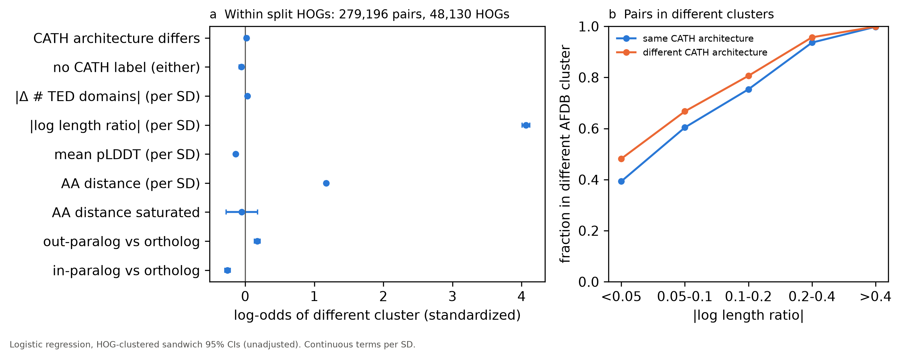

**Figure 11. Ortholog groups split across AFDB clusters mainly because their members differ in length, not because their domain architecture differs.** **(a)** Standardised log-odds (95% HOG-clustered CIs) that two members of one HOG fall in different clusters (279,196 pairs in 48,130 split HOGs): length ratio 4.06 per SD, AA distance 1.17, CATH architecture difference near 0. **(b)** Fraction of pairs in different clusters against |log length ratio|, for pairs with the same (blue) or different (orange) CATH architecture; a different architecture adds only 5–9 percentage points per length bin.

### 5.3 Case studies: no robust structural burst; per-branch ratios depend on method

The case studies asked whether particular lineages carry unusually much structural change per sequence change. For each branch, ρ is its 3Di/AA ratio relative to the whole tree (ρ = 1 typical). All results are exploratory.

**Cytoskeleton (actin and tubulin folds; 400 proteins per superfamily from eukaryotes and the prokaryote panel).** The result is negative. The path from prokaryotic actins to the eukaryote + Asgard ancestor gives ρ = 1.40 with MAFFT alignments [0.88, 2.38] and 1.57 with FAMSA, but 0.64 with structure-guided FoldMason alignments and 0.71 with the pairwise branch engine; the tubulin stem gives 1.14 (MAFFT) against 0.56 (FoldMason). Sequence alignments lean high and structure-guided ones low, the signature of alignment error at depth; a site-heterogeneous AA model (LG+C20) brings values to about 1, and on constrained topologies not rejected by AU tests (Shimodaira 2002; actin p = 0.061, tubulin p = 0.32) the eukaryote-only stem has zero length. The one robust signal is on the branch *below* crenactin (ρ = 2.40 [1.52, 5.71], MAFFT). Within eukaryotes, robust high flags are almost all single terminal branches (e.g. *Trichomonas* β- and γ-tubulin), enriched for low-pLDDT models.

**Kinases (protein kinase-like fold; 500 kinase domains).** At most a weak tendency. The two branches at the origin of holozoan tyrosine kinases have ρ = 1.68 (MAFFT), 1.47 (FAMSA) and 2.00 (FoldMason), the 88th–91st percentile of comparable branches: consistent in direction but never above the 95th percentile, and on short branches (0.17 AA substitutions per site). Prokaryotic and eukaryotic kinases do not differ (ratio 1.02–1.22×, all CIs including 1), and only 1 of 12 flagged branches is flagged under all three alignments.

**Method dependence (Figure 12).** On internal branches, per-branch AA lengths agree between the IQ-TREE joint-likelihood fit and the pairwise branch engine (Spearman 0.77 for actin, 0.83 for tubulin), but per-branch ρ barely agrees (Spearman 0.16 and 0.32). Other reasonable branch subsets give 0.68–0.83 for AA lengths and 0.14–0.38 for ρ. Single-branch structural "accelerations" are therefore unreliable, which independently supports the ratio-of-sums pooling used in Goal 1.

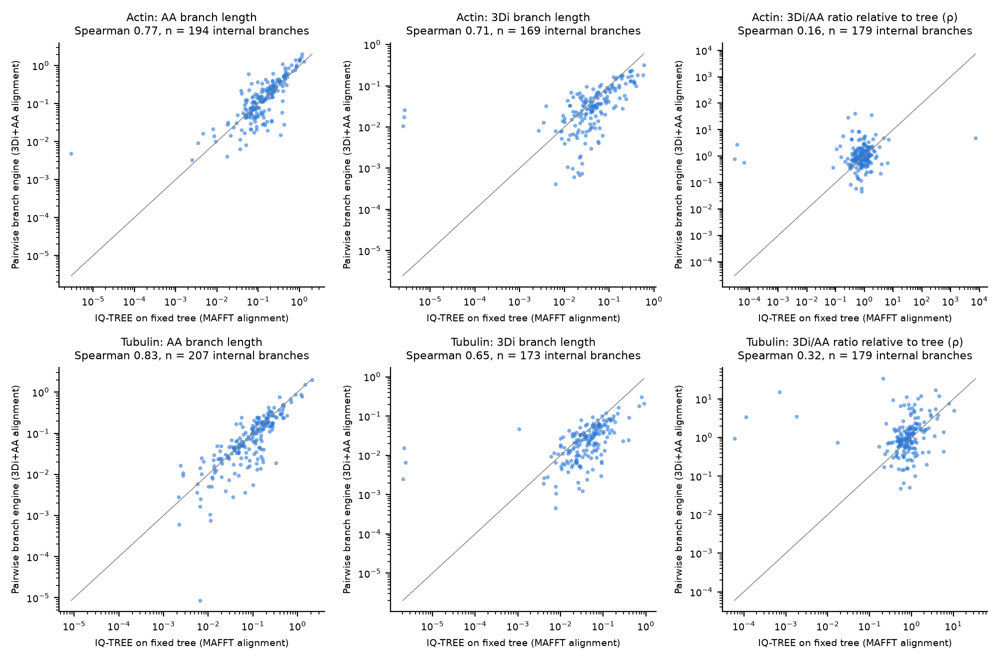

**Figure 12. Single-branch estimates agree between methods for sequence but not for the structure-to-sequence ratio.** Internal branches of the actin (top) and tubulin (bottom) trees with positive lengths under both methods. x: IQ-TREE on the fixed reference tree (MAFFT alignment); y: the pairwise branch engine (3Di+AA alignment); log axes; grey line: equality. Columns: AA branch length, 3Di branch length, and ρ (3Di/AA ratio relative to the whole tree). Spearman correlations are given in each panel title.

---

## 6 Discussion

**Main point.** Across thousands of eukaryotic ortholog families, 3Di structure looks like a slowed-down copy of the sequence clock: on internal branches its rate relative to sequence is roughly constant (post hoc), at about one-fifth. The more dramatic pre-registered answers (saturation, an age trend, lineage effects) share one likely technical source: an extra per-protein offset that behaves like residual noise in AlphaFold predictions, although a fast-saturating real structural component cannot be excluded. The main lessons concern how to measure structural evolution with predicted structures, not a new law of structural evolution.

### 6.1 Answers to the three questions

**(1) Is structural divergence linear in sequence divergence?** *Shown:* the pre-registered estimator finds ĉ = 0.72, but (post hoc, independently checked) it leans concave whenever per-protein offsets exist, and they do; post-hoc estimators that allow for them bracket the curvature between about 0.75 and 1.0. *Believed:* roughly linear above a small step between non-identical orthologs, part of which is AlphaFold noise that tracks pLDDT. This agrees with Illergård et al. (2009) and Koehl & Levitt (2002), and not with the saturation implied by Chothia & Lesk's exponential once it is rewritten on a substitution axis (our own derivation, not the authors'). Our range stops at 2 AA substitutions per site, where saturation would start to matter. Two experiments would settle what the step is: a same-protein floor from independent experimental structures of one protein (PDB–PDB), or AlphaFold models of identical sequences built with varied MSA depth, to test whether model noise alone reproduces the offset.

**(2) Is structure 3–10× more conserved than sequence?** *Shown:* yes: k = 3.3 over all branches and 4.6 on internal branches (headline chosen post hoc), with β-rich families changing 3Di about 1.8× faster per substitution than α-helical ones, as Illergård reported for secondary structure (over all branches; not recomputed on internal branches, so part of it could be the tip artefact). *Believed:* families vary two- to threefold around 4.6. The new element is the matched 20-state comparison; the number is specific to 3Di and to predicted structures.

**(3) Is there a structural molecular clock, and is it neutral?** *Shown:* once the AlphaFold artefact is set aside, there is no robust age trend in the ratio and no lineage-specific structural rate on internal branches; both are absence-of-evidence results (internal age-slope SE ≈ 0.035; E5 power 0.24). *Not shown:* neutrality. A constant ratio fits the view that structural change is mostly a passive by-product of substitutions (Echave & Wilke 2017), but is equally expected if purifying selection acts on both alphabets proportionally. *Believed:* on internal branches 3Di distance is proportional to AA distance (a "rescaled clock" in the sense of §1.4) and adds little independent timing information.

This sits between the published views. Pascual-García et al. (2019) found larger clock violations in structure, linked to function change; Moi et al. (2025) found structure-informed trees the most clock-like. Our design, with orthologs only and ratios rather than absolute rates, removes much of the functional divergence that Pascual-García's superfamilies contained. The duplication result (E6b) points their way, although its size equals the per-model offset and was not adjusted for pLDDT differences between copies: where function is expected to change, after duplication, extra structural change appears.

### 6.2 Practical consequences for structural phylogenetics with AlphaFold models

1. **Terminal branches of 3Di trees are inflated** by about 0.01–0.017 substitutions per site per model, more at low pLDDT; below about 30 My, 3Di branch lengths are mostly noise. Floors should be protein- or family-specific, or a tip-specific error term; FoldTree's filtering of low-pLDDT families (Moi et al. 2025) points the same way.
2. **Deep 3Di branches carry information proportional to AA branches.** At about 4.6 AA substitutions per 3Di substitution, a 3Di tree length of 0.5 corresponds to about 2.3 AA substitutions per site, where AA distances become unreliable. This supports 3Di for remote homology and deep phylogeny (van Kempen et al. 2024; Puente-Lelievre et al. 2023), but not as an *independent* clock.
3. **AlphaFold models understate ortholog divergence by 30–40%** without flattening the curve. Absolute AF distances are not comparable to crystal-structure distances; slopes and ratios are less affected, although the experimental set was small (197 pairs).
4. **AFDB clusters should not be used as orthology groups or for dating.** Membership is driven by the length-coverage rule, cluster LCAs match orthology ages for only about a quarter of clusters, and in-cluster curves describe a pre-selected population. This qualifies rather than contradicts Barrio-Hernandez et al. (2023), whose clusters were built for structural search and annotation.
5. **Single-branch structural "bursts" need multiple methods.** In both case studies per-branch ratios depended on alignment and estimator, and strong flags were enriched for low-confidence models.

### 6.3 How the agentic process performed

**Main point.** The safeguards caught what they were designed to catch: pre-registration protected the decisions, a pilot run and simulations caught three flaws before confirmation, and independent re-derivation confirmed the arithmetic. The most consequential flaw, a fixed noise floor taken from one kind of control, passed the design, three review rounds and the calibration simulations, and was found only by a critical review after confirmation.

**What went well.** Pre-registration, checksum guards and the deviation log made the single confirmation run auditable, and the six decisions are reported unchanged even where we now doubt them. The pilot on real data caught the TM-align misalignment problem, which no reviewer had predicted. Simulation exposed two estimator biases (in the curvature and age-slope estimators) before confirmation, and E5's margins were not widened when it proved unable to accept its null. Independent checking worked: the independent re-derivation reproduced 42/42 numbers, and the verifier of the post-hoc review partly refuted it, so the report uses its more cautious range. Delegation with written reports kept the PI's context small, and the node move needed no rebuilding.

**What went badly.**
- **The noise floor was a design flaw the safeguards did not catch.** η was fixed from identical-sequence pairs and treated as known. Reviews questioned AlphaFold artefacts but not whether *non-identical* sequences carry extra model noise, and the calibration simulations used the same fixed floor, so they verified the estimator only under the assumed noise model. Pre-registration guarantees that a wrong noise model is applied honestly, not that it is right.
- **The signal was visible before confirmation.** In the tuning dry run the internal-branch E4 slope was already near zero (−0.014), and the AF-versus-PDB analysis had already shown AF noise to be an offset. Lesson: compare every key sensitivity with the primary result on tuning data before freezing.
- **A planned sensitivity was missing from the output** (ν ± 0.005). The re-derivation checked the numbers that existed, not whether every specified number existed; the review found the gap, and it was computed afterwards.
- **Some tests were weak by construction:** E5 could not accept its null (power 0.24) and E1 detected c = 0.90 only 55% of the time. Both were known before confirmation and reported, but ideally would have changed the design, not only its caveats.
- **Exploratory work competed with the critical path,** and one exploratory analysis touched confirmation families (118 pairs); neither affected a decision.

---

## 7 Limitations

**Main point.** All conclusions concern AlphaFold models of well-predicted, mostly ordered eukaryotic proteins, measured with one structural alphabet over 0.05–2 AA substitutions per site. The two key post-hoc reinterpretations (per-model noise and the internal-branch ratio) were checked by a second agent but were not pre-registered.

- **Structures and measures.** All structures are predictions; the AF-versus-crystal comparison rests on 197 mostly human–mouse pairs. No pre-registered estimator modelled the per-model noise, so the post-hoc curvature bracket (about 0.75–1.0) and internal k (4.6) remain interpretations. Whether the extra offset is model noise or a fast-saturating real structural change is unresolved. 3Di describes local tertiary contacts, and only the confident core was used, excluding loops, disorder and indels, where much structural change happens.
- **Sampling.** The pLDDT filter removed 38% of genes. Only 224 families were in the youngest stratum, and terminal branches dominate young ages. Divergence was capped at 2 AA substitutions per site. Proteins over 2,700 residues and several model organisms are absent. The 4,891 analysed families passed misfit and fit-quality screens, under-representing hidden paralogy and gene-tree discordance.
- **Orthology and time.** Ancestra is unverified AI-generated software (ortholog calls checked well against Ensembl; duplication timing did not and was not used). TimeTree resolves deep eukaryotic splits crudely (52% of pairs at the root age, 6 imputed node ages); alternative deep-age calibrations cover only 3–11 nodes.
- **Statistics.** E1/E2 had low power (c = 0.90 detected 55% of the time), E4 recovers about 46% of a true slope, and E5 had power 0.24. E3's between-family SD estimator failed; the robust values (0.25–0.47 on the log scale) are post hoc. E6a is not alignment-robust, and E6b was not adjusted for model quality. The α/β fold-class contrast in k was not recomputed on internal branches. The E4 permuted-age negative control was run on the tuning set (20/20 pass) but not on the confirmation set. The independent re-derivation found three minor issues that change no result: two families with an undefined misfit ratio were kept; E5's contrast count is overstated by one (145 enter the slope); and the written description of the curvature bias correction does not match the code, which simulates tree-additive design with pair-level noise. A small orientation asymmetry in the sequence-only alignment adds noise to the family-selection distance; the split was frozen and not corrected.
- **Goal 2.** All Goal 2 analyses except E6 are exploratory and were not independently re-derived. The case studies rest on 400–500 sequences per family, one Asgard genome, no Asgard tubulin and AA-saturated deep branches.
- **Process.** Everything was done by AI agents within 48 h of compute; no human has verified the methods or results.

---

## Data and code availability

**Main point.** Code, configuration, pre-registration records, confirmatory results and agent reports are in the git repository; raw data are not, but every dataset is listed with source, version, checksum and licence in DATA.md and can be re-downloaded with the provided scripts.

| Path | Contents |
|---|---|
| `PROMPT.md`, `RESEARCH_TREE.md`, `LESSONS.md`, `LITERATURE.md`, `DESIGN.md`, `reviews/`, `agents/` | Brief, research record, process rules, literature, design, reviews, subagent reports |
| `ANALYSIS_PLAN.md`, `DEVIATIONS.md`, `RESULTS_LEDGER.md`, `config/` | Frozen plan, every later change, ledger of reported numbers with checksums, seeds and tuned values |
| `src/strucevo/`, `scripts/`, `tests/` | Distance library, pair pipeline, statistics engines; pipeline stages; automated tests |
| `results/`, `figures/` | Confirmatory (`results/endpoints/`), verification, post-hoc and exploratory results; figures with binned data |

**Data.** DATA.md lists AFDB clusters v3/v6, AFDB v4 FoldComp archives, UniProt 2026_03 reference proteomes, NCBI Taxonomy, TED, Pfam 38.2, PDB/SIFTS, TimeTree and the deep-age literature tables. TimeTree data may not be redistributed, so divergence times are never committed; committed tables carry age-bin labels only, and `scripts/panel/` re-queries TimeTree.

**Reproducing the analysis.** Seeds derive from 20261030; every filter logs counts in and out; every reported number has a line in RESULTS_LEDGER.md (script, commit, input checksum). Create the conda environment from `envs/` (Foldseek with GPU support); download data with the scripts in `scripts/`; run Ancestra (commit ffb0bbe; about 5 h and 161 GB of memory on 180 proteomes), then the HOG build, pair metrics, floors and tuning stages. Each long stage writes a completion marker and can be resumed (NODE_MOVE.md). The confirmation run is `CONFIRM_RUN=1 python scripts/endpoints/run_confirm.py` (about 1.8 h); it refuses to run if checksums differ from the ledger or the code tree is not clean. Main figures: `CONFIRM_RUN=1 python scripts/exploratory/figures_main.py`.

---

## Supplementary figure

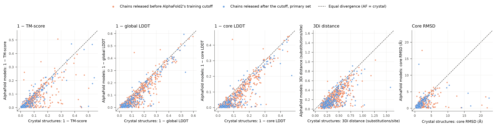

**Figure S1. AlphaFold versus crystal-structure divergence for all five measures.** As Figure 8, for 1 − TM-score (normalised by the shorter protein), 1 − global LDDT, 1 − core LDDT, 3Di distance and core RMSD. Blue: chains released after AlphaFold2's training cutoff (197 pairs, primary set); orange: earlier chains (484–485 pairs, depending on the measure). Dashed line: equal divergence.

---

## References

All identifiers were checked against PubMed, bioRxiv or the publisher record.

- Altenhoff AM, Studer RA, Robinson-Rechavi M, Dessimoz C (2012). Resolving the ortholog conjecture: orthologs tend to be weakly, but significantly, more similar in function than paralogs. *PLoS Comput Biol* 8:e1002514. doi:10.1371/journal.pcbi.1002514. PMID 22615551.
- Ancestra (2026). evocellnet/ancestra-mvp-ai, commit ffb0bbe. AI-generated hackathon software, not peer reviewed. https://github.com/evocellnet/ancestra-mvp-ai
- Barrio-Hernandez I, et al. (2023). Clustering predicted structures at the scale of the known protein universe. *Nature* 622:637–645. doi:10.1038/s41586-023-06510-w. PMID 37704730.
- Betts HC, Puttick MN, Clark JW, Williams TA, Donoghue PCJ, Pisani D (2018). Integrated genomic and fossil evidence illuminates life's early evolution and eukaryote origin. *Nat Ecol Evol* 2:1556–1562. doi:10.1038/s41559-018-0644-x. PMID 30127539.
- Bromham L, Penny D (2003). The modern molecular clock. *Nat Rev Genet* 4:216–224. doi:10.1038/nrg1020. PMID 12610526.
- Buel GR, Walters KJ (2022). Can AlphaFold2 predict the impact of missense mutations on structure? *Nat Struct Mol Biol* 29:1–2. doi:10.1038/s41594-021-00714-2. PMID 35046575.
- Chothia C, Lesk AM (1986). The relation between the divergence of sequence and structure in proteins. *EMBO J* 5:823–826. doi:10.1002/j.1460-2075.1986.tb04288.x. PMID 3709526.
- Cock PJA, et al. (2009). Biopython: freely available Python tools for computational molecular biology and bioinformatics. *Bioinformatics* 25:1422–1423. doi:10.1093/bioinformatics/btp163. PMID 19304878.
- Cook JR, Stefanski LA (1994). Simulation-extrapolation estimation in parametric measurement error models. *J Am Stat Assoc* 89:1314–1328. doi:10.1080/01621459.1994.10476871.
- Daumiller D, Li Q, Bryant P (2026). The structural history of Eukarya. *Sci Adv* 12:eaeh2524. doi:10.1126/sciadv.aeh2524. PMID 42950045.
- Deorowicz S, Debudaj-Grabysz A, Gudyś A (2016). FAMSA: fast and accurate multiple sequence alignment of huge protein families. *Sci Rep* 6:33964. doi:10.1038/srep33964. PMID 27670777.
- DerSimonian R, Laird N (1986). Meta-analysis in clinical trials. *Control Clin Trials* 7:177–188. doi:10.1016/0197-2456(86)90046-2. PMID 3802833.
- Echave J, Wilke CO (2017). Biophysical models of protein evolution: understanding the patterns of evolutionary sequence divergence. *Annu Rev Biophys* 46:85–103. doi:10.1146/annurev-biophys-070816-033819. PMID 28301766.
- Fullmer MS, Puente-Lelievre C, Matzke NJ (2025). Adding 3Di characters to amino acid datasets can improve resolution, but the effect is weaker in shorter and alpha-helical proteins such as histones. *bioRxiv* preprint. doi:10.1101/2025.06.30.662300.
- Garg SG, Hochberg GKA (2025). A general substitution matrix for structural phylogenetics. *Mol Biol Evol* 42:msaf124. doi:10.1093/molbev/msaf124. PMID 40476610.
- Gilchrist CLM, Mirdita M, Steinegger M (2026). Multiple protein structure alignment at scale with FoldMason. *Science* 391:485–488. doi:10.1126/science.ads6733. PMID 41610233.
- Holm S (1979). A simple sequentially rejective multiple test procedure. *Scand J Stat* 6:65–70. JSTOR 4615733.
- Illergård K (2010). *On the effects of structure and function on protein evolution.* PhD thesis, Stockholm University. urn:nbn:se:su:diva-35872.
- Illergård K, Ardell DH, Elofsson A (2009). Structure is three to ten times more conserved than sequence—a study of structural response in protein cores. *Proteins* 77:499–508. doi:10.1002/prot.22458. PMID 19507241.
- Jumper J, et al. (2021). Highly accurate protein structure prediction with AlphaFold. *Nature* 596:583–589. doi:10.1038/s41586-021-03819-2. PMID 34265844.
- Katoh K, Standley DM (2013). MAFFT multiple sequence alignment software version 7: improvements in performance and usability. *Mol Biol Evol* 30:772–780. doi:10.1093/molbev/mst010. PMID 23329690.
- Kimura M (1968). Evolutionary rate at the molecular level. *Nature* 217:624–626. doi:10.1038/217624a0. PMID 5637732.
- Koehl P, Levitt M (2002). Sequence variations within protein families are linearly related to structural variations. *J Mol Biol* 323:551–562. doi:10.1016/S0022-2836(02)00971-3. PMID 12381308.
- Kumar S, et al. (2022). TimeTree 5: an expanded resource for species divergence times. *Mol Biol Evol* 39:msac174. doi:10.1093/molbev/msac174. PMID 35932227.
- Lau AM, et al. (2024). Exploring structural diversity across the protein universe with The Encyclopedia of Domains. *Science* 386:eadq4946. doi:10.1126/science.adq4946. PMID 39480926.
- Le SQ, Gascuel O (2008). An improved general amino acid replacement matrix. *Mol Biol Evol* 25:1307–1320. doi:10.1093/molbev/msn067. PMID 18367465.
- Ly-Trong N, Naser-Khdour S, Lanfear R, Minh BQ (2022). AliSim: a fast and versatile phylogenetic sequence simulator for the genomic era. *Mol Biol Evol* 39:msac092. doi:10.1093/molbev/msac092. PMID 35511713.
- Manni M, Berkeley MR, Seppey M, Simão FA, Zdobnov EM (2021). BUSCO update: novel and streamlined workflows along with broader and deeper phylogenetic coverage for scoring of eukaryotic, prokaryotic, and viral genomes. *Mol Biol Evol* 38:4647–4654. doi:10.1093/molbev/msab199. PMID 34320186.
- Mariani V, Biasini M, Barbato A, Schwede T (2013). lDDT: a local superposition-free score for comparing protein structures and models using distance difference tests. *Bioinformatics* 29:2722–2728. doi:10.1093/bioinformatics/btt473. PMID 23986568.
- Mistry J, et al. (2021). Pfam: the protein families database in 2021. *Nucleic Acids Res* 49:D412–D419. doi:10.1093/nar/gkaa913. PMID 33125078.
- Moi D, Bernard C, Steinegger M, Nevers Y, Langleib M, Dessimoz C (2025). Structural phylogenetics unravels the evolutionary diversification of communication systems in gram-positive bacteria and their viruses. *Nat Struct Mol Biol* 32:2492–2502. doi:10.1038/s41594-025-01649-8. PMID 41073779.
- Nehrt NL, Clark WT, Radivojac P, Hahn MW (2011). Testing the ortholog conjecture with comparative functional genomic data from mammals. *PLoS Comput Biol* 7:e1002073. doi:10.1371/journal.pcbi.1002073. PMID 21695233.
- Ohta T (1973). Slightly deleterious mutant substitutions in evolution. *Nature* 246:96–98. doi:10.1038/246096a0. PMID 4585855.
- Pak MA, et al. (2023). Using AlphaFold to predict the impact of single mutations on protein stability and function. *PLoS One* 18:e0282689. doi:10.1371/journal.pone.0282689. PMID 36928239.
- Pascual-García A, Arenas M, Bastolla U (2019). The molecular clock in the evolution of protein structures. *Syst Biol* 68:987–1002. doi:10.1093/sysbio/syz022. PMID 31111152.
- Puente-Lelievre C, et al. (2023). Tertiary-interaction characters enable fast, model-based structural phylogenetics beyond the twilight zone. *bioRxiv* preprint. doi:10.1101/2023.12.12.571181.
- Puente-Lelievre C, Malik A, Douglas J (2025). Protein structural phylogenetics. *Genome Biol Evol* 17:evaf139. doi:10.1093/gbe/evaf139. PMID 40839422.
- Schoch CL, et al. (2020). NCBI Taxonomy: a comprehensive update on curation, resources and tools. *Database* 2020:baaa062. doi:10.1093/database/baaa062. PMID 32761142.
- Shimodaira H (2002). An approximately unbiased test of phylogenetic tree selection. *Syst Biol* 51:492–508. doi:10.1080/10635150290069913. PMID 12079646.
- Strassert JFH, Irisarri I, Williams TA, Burki F (2021). A molecular timescale for eukaryote evolution with implications for the origin of red algal-derived plastids. *Nat Commun* 12:1879. doi:10.1038/s41467-021-22044-z. PMID 33767194.
- van Kempen M, et al. (2024). Fast and accurate protein structure search with Foldseek. *Nat Biotechnol* 42:243–246. doi:10.1038/s41587-023-01773-0. PMID 37156916.
- Warwick Vesztrocy A, Glover N, Thomas PD, Dessimoz C, Julca I (2025). Unveiling the functional fate of duplicated genes through expression profiling and structural analysis. *Genome Res* 35:2273–2284. doi:10.1101/gr.280166.124. PMID 40813247.
- Wong TKF, et al. (2026). IQ-TREE 3: phylogenomic inference software using complex evolutionary models. *Mol Biol Evol* 43:msag117. doi:10.1093/molbev/msag117. PMID 42085559.
- Wood TC, Pearson WR (1999). Evolution of protein sequences and structures. *J Mol Biol* 291:977–995. doi:10.1006/jmbi.1999.2972. PMID 10452901.
- Yang Z (1994). Maximum likelihood phylogenetic estimation from DNA sequences with variable rates over sites: approximate methods. *J Mol Evol* 39:306–314. doi:10.1007/BF00160154. PMID 7932792.
- Zhang Y, Skolnick J (2004). Scoring function for automated assessment of protein structure template quality. *Proteins* 57:702–710. doi:10.1002/prot.20264. PMID 15476259.
- Zuckerkandl E, Pauling L (1965). Evolutionary divergence and convergence in proteins. In Bryson V, Vogel HJ (eds), *Evolving Genes and Proteins*, Academic Press, New York, pp. 97–166.
